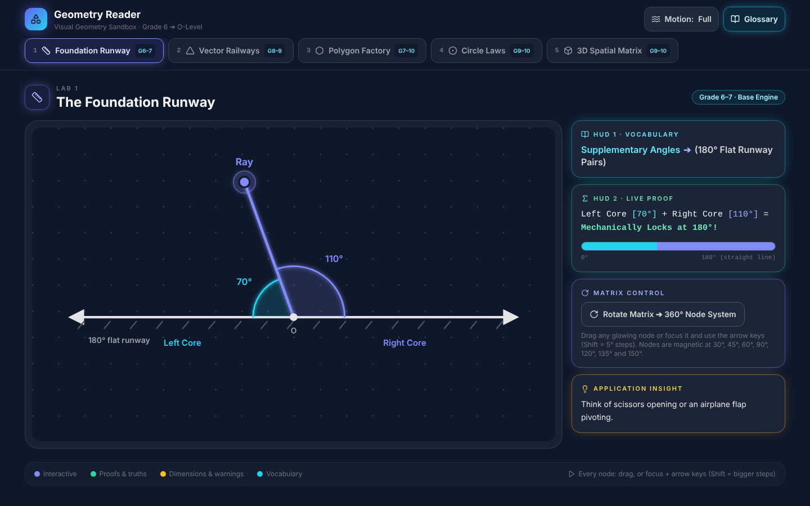

# Geometry Reader

**See geometry move, instead of memorising it.** Geometry Reader is an interactive, browser-based geometry sandbox for students from Grade 6 to O-Level. Students drag points, lines and solids, and every angle, length, area and volume updates live, so theorems are discovered rather than recited.

**Live demo:** https://wasemafarzana1.github.io/geometry-reader-showcase/ (the app itself is in [`demo/`](demo/), as built and minified output) · **Status:** working prototype covering 19 of 65 planned geometry topics, not yet tested with students · **Author:** Wasema Farzana

## Why it exists
In Bangladesh, the best tutoring and learning resources are concentrated among Dhaka's affluent, English-medium families. Students elsewhere, including in the author's home region of northern Bangladesh, fall behind for lack of access, and that gap is later called a gap in "merit". Geometry Reader aims to put a high-quality visual geometry resource within reach of any student with a browser. **[Read the full story →](STORY.md)**

## What it does
| Lab | Topic | What the student does |
|---|---|---|
| 1 · Foundation Runway | Angles on a line and at a point | Drags a ray and watches the two angles always sum to 180°, then expands it into a full 360° turn. |
| 2 · Vector Railways | Parallel lines and triangles | Tilts a line crossing two parallel rails and lights up the Z, F, C and X angle patterns; reshapes a triangle and sees the outside angle equal the two opposite inside ones. |
| 3 · Polygon Factory | Interior and exterior angles | Changes the number of sides from 3 to 10, splits the shape into triangles, and walks around its edge to watch the turns add up to 360°. |
| 4 · Circle Laws | All seven circle theorems | Slides points round a circle and watches each theorem hold. |
| 5 · 3D Spatial Matrix | Solids, nets and scale | Unfolds four solids into flat nets and scales them up to see lengths grow ×k, areas ×k² and volumes ×k³. |

<table>
  <tr>
    <td></td>
    <td></td>
  </tr>
  <tr>
    <td></td>
    <td></td>
  </tr>
</table>

## Design principles
- **Topics first, curriculum second.** Each lab teaches the topic in depth, and matching it to O-Level, the national SSC/HSC syllabus or English Version is a separate layer.
- **Nothing hidden.** Every value is shown live as the student moves things.
- **Two kinds of language.** Every formal term sits beside a plain-language translation, e.g. *Supplementary Angles ➔ (180° Flat Runway Pairs)*.
- **Each colour has one job.** Indigo = something you can move, mint = proofs and truths, amber = measurements and warnings, cyan = vocabulary.
- **Built for every body and nervous system.** Large drag targets that snap to key values, full keyboard control, and a Calm mode that switches off flashes and motion.
- **Mathematically honest.** Where a simple rule has exceptions, the lab shows them, e.g. dented polygons.

The reasoning behind each choice is recorded in the **[decision log](DECISIONS.md)**.

## Roadmap
The goal is complete coverage of school geometry, from the idea of a point to O-Level and then college level. The **[curriculum map](CURRICULUM.md)** tracks every topic and its status.

1. **Now:** English version on the O-Level syllabus, refined with English-medium and English Version students.
   - **Proof Mode:** step-by-step explanations of *why* each theorem holds, starting with the theorems already in the app.
   - **Then:** a Foundations lab (point, line, angle, shapes), a Quadrilateral Family lab, and 2D mensuration with every formula derived on screen.
2. **Next:** match every lab to the national SSC/HSC (NCTB) syllabus, and release a full Bangla version.
3. **Then:** college-level topics, and further "Readers" for other areas of mathematics.
4. **Throughout:** testing on low-cost phones, and classroom studies outside Dhaka. See the **[research agenda](RESEARCH.md)**.

## Documentation
| Document | For | Contents |
|---|---|---|
| [STORY.md](STORY.md) | Everyone | Why Geometry Reader exists |
| [CURRICULUM.md](CURRICULUM.md) | Educators, reviewers | Every planned topic, its grade, what it builds on, and its status |
| [DECISIONS.md](DECISIONS.md) | Reviewers, partners | Every major design decision, who made it, and why |
| [RESEARCH.md](RESEARCH.md) | Academics, funders | Research questions, hypotheses, study plan, ethics |
| [AI_USE.md](AI_USE.md) | Everyone | What the author did, and what the AI coding assistant did |
| [LICENSE](LICENSE) | Partners, buyers | Proprietary licence terms |

## How it is built
The author directs the design. An AI coding assistant writes the code from the author's briefs, under the author's review; see [AI_USE.md](AI_USE.md). Technically, it is a single-page React 18 app styled with Tailwind CSS, built as a shared engine (geometry maths, interaction, feedback and design system) with one module per topic, so new topics reuse the same foundations. All geometry and 3D rendering are hand-written SVG maths, with no 3D or physics libraries. It runs entirely in the browser: no server, no accounts, no data collection.

Checks performed so far: lint and production build on every push; a numerical test that the 3D nets unfold flat with surface area preserved; a scripted browser walk-through of all five labs; and a check that the layout works on a phone-width screen.

The source code is kept in a private repository. Authorised reviewers can be given access under a non-disclosure agreement; ask the author.

## About the author
**Wasema Farzana** is a mathematics educator teaching Grade 8 to O-Level students across English-medium and English Version curricula in Bangladesh. Geometry Reader is the first project in a planned series of visual mathematics tools, and part of the author's work at the intersection of HCI, education and AI & Society.

For collaboration, research or licensing enquiries, contact the author through [GitHub](https://github.com/wasemafarzana1).

## Licence
Copyright © 2026 Wasema Farzana. All rights reserved. This is **not** open-source software. No part of it may be used, copied, modified, distributed or sold without written permission. See [LICENSE](LICENSE).
